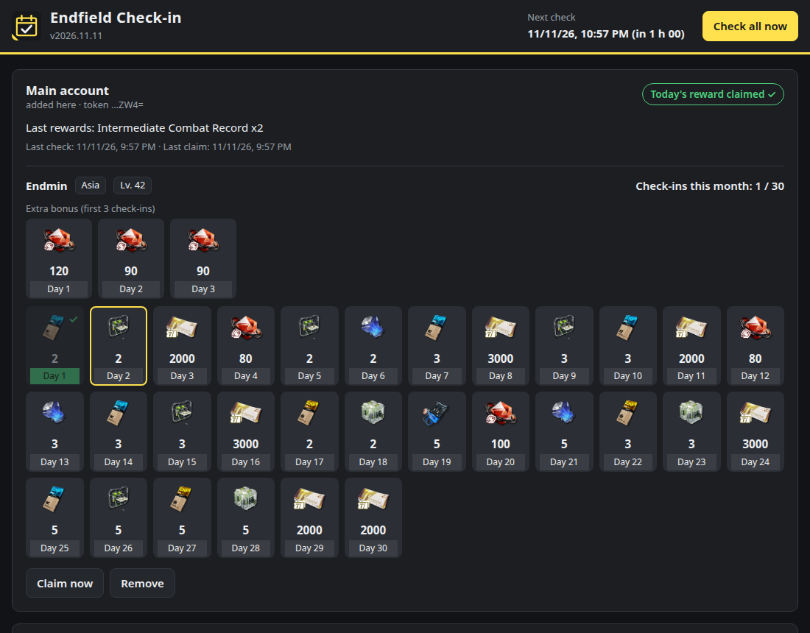

# Endfield Check-in pour Unraid

[English](README.md) · [Signaler un problème](https://github.com/MrPatates/endfield-checkin/issues)

Un conteneur Docker qui récupère automatiquement les récompenses de connexion quotidienne d'**Arknights: Endfield** sur la [page de check-in SKPORT](https://game.skport.com/endfield/sign-in). Tu connectes ton compte une fois depuis l'interface web, puis le bot récupère la récompense chaque jour pour tous les personnages liés au compte.

Projet communautaire, non affilié à GRYPHLINE, Hypergryph ou SKPORT.



## Fonctionnalités

- Connexion par **jeton de compte** (`ACCOUNT_TOKEN`) ou par **e-mail + mot de passe**.
- Plusieurs comptes, et tous les personnages Endfield de chaque compte (détection automatique du serveur).
- Vérification toutes les 2 h par défaut : la récompense est récupérée dès qu'elle est disponible, quelle que soit l'heure de réinitialisation de la région du serveur. Après une erreur réseau ou serveur, nouvel essai au bout de 15 min.
- Interface web en français ou en anglais : calendrier du mois, bonus des trois premières connexions, dernières récompenses, historique et bouton « Récupérer maintenant ».
- Notifications Discord optionnelles : récompenses, erreurs, jeton expiré.
- Image légère (~50 Mo), Python sans aucune dépendance externe. Le conteneur passe en utilisateur `99:100` (nobody:users) après le démarrage.

## Fonctionnement

Le bot fait les mêmes appels que la page web officielle :

1. `ACCOUNT_TOKEN` → code OAuth (`as.gryphline.com`) ;
2. code → `cred` et jeton de signature (`zonai.skport.com`) ;
3. liste des personnages Endfield liés au compte ;
4. statut du check-in (`hasToday`) ; si la récompense n'est pas encore prise, envoi du check-in signé (HMAC-SHA256 puis MD5, comme sur le site).

Chaque vérification coûte une requête légère par personnage. La session est gardée en mémoire et renouvelée automatiquement à partir du jeton.

## Installation sur Unraid

1. Ouvre l'onglet **Apps** (Community Applications) et cherche **Endfield Check-in**.
2. Clique sur **Install**. Choisis éventuellement la langue des récompenses (`fr_FR`), un webhook Discord ou un mot de passe d'interface, puis clique sur **Apply**.
3. Ouvre la **WebUI** depuis l'onglet Docker (`http://<ip-unraid>:8080`) et connecte ton compte.

Les mises à jour sont proposées dans l'onglet Docker, comme pour les autres conteneurs.

## Connecter son compte

**Méthode du jeton (recommandée)**

1. Ouvre <https://game.skport.com/endfield/sign-in> et connecte-toi.
2. Appuie sur **F12**. Dans Chrome/Edge, va dans **Application → Cookies** ; dans Firefox, va dans **Stockage → Cookies**.
3. Sélectionne `https://game.skport.com` et copie la valeur du cookie **`ACCOUNT_TOKEN`**.
4. Colle-la dans l'interface web, puis clique sur **Connecter le compte**. Le jeton est vérifié avant d'être enregistré, puis une première récupération démarre.

**Méthode e-mail + mot de passe**

Le bot se connecte une fois et ne garde que le jeton obtenu. Si tu coches « Mémoriser », l'e-mail et le mot de passe sont aussi stockés dans `/config` pour se reconnecter automatiquement quand le jeton expire. Les comptes créés avec Google, Apple, etc. n'ont pas de mot de passe : utilise alors le jeton.

Quand un jeton expire sans mot de passe enregistré, l'interface affiche **Action requise** et Discord te prévient (une seule fois). Il suffit de reconnecter le compte.

## Réglages (variables du template)

| Variable | Défaut | Rôle |
| --- | --- | --- |
| `CHECK_INTERVAL` | `120` | Minutes entre deux vérifications (30–720). |
| `SKPORT_LANGUAGE` | `en` | Langue des noms de récompenses : `en`, `fr_FR`, `de_DE`, `it_IT`, `es_MX`, `pt_BR`, `ru_RU`, `ja`, `ko`, `zh_Hans`, `zh_Hant`, `id_ID`, `th_TH`, `vi_VN`. `fr_FR` met aussi les notifications Discord en français. |
| `DISCORD_WEBHOOK` | vide | URL de webhook Discord (optionnelle). |
| `NOTIFY` | `all` | `all` = récompenses et erreurs, `errors` = erreurs seulement, `none` = aucune notification. |
| `WEBUI_PASSWORD` | vide | Protège l'interface par un mot de passe (n'importe quel nom d'utilisateur). |
| `ACCOUNT_TOKEN` | vide | Avancé : jeton(s) séparés par des virgules, à la place de l'interface web. |
| `ACCOUNT_NAME` | vide | Nom affiché pour les comptes définis par `ACCOUNT_TOKEN`. |
| `RETRY_INTERVAL` | `15` | Minutes avant un nouvel essai après une erreur (5–240). |
| `PUID` / `PGID` | `99` / `100` | Propriétaire des fichiers de `/config`. |
| `LOG_LEVEL` | `INFO` | `DEBUG`, `INFO`, `WARNING`, `ERROR`. |

Unraid transmet `TZ` automatiquement : les heures affichées et les logs suivent le fuseau du serveur.

## Sécurité

- Le jeton `ACCOUNT_TOKEN` donne accès à ton compte, comme un mot de passe. Il est stocké dans `/config/accounts.json` en mode `0600`, n'apparaît jamais dans les logs et n'est jamais renvoyé par l'interface, qui n'affiche que ses 4 derniers caractères.
- L'interface est prévue pour ton réseau local. Ne l'expose pas sur Internet ; définis `WEBUI_PASSWORD` si d'autres personnes utilisent ton réseau.
- Les actions de l'interface sont protégées contre le CSRF (jeton + JSON obligatoire + contrôle de l'origine), et une politique CSP stricte est appliquée.
- Les requêtes vont uniquement vers `as.gryphline.com`, `zonai.skport.com`, et vers ton webhook Discord si tu en configures un. Les icônes des récompenses sont chargées par ton navigateur depuis `static.skport.com`.

## Limites

Ce bot repose sur l'API non documentée du site SKPORT, analysée à partir de la page officielle et de projets open source. Il peut cesser de fonctionner si SKPORT modifie son API. L'automatisation peut aussi être contraire aux conditions d'utilisation du service : utilise-le à tes risques.

## Développement

```bash
cd tests && python3 -m unittest discover -s . -t . -v   # 25 tests, faux serveur SKPORT inclus
podman build --format docker -t endfield-checkin:dev .  # ou docker build
```

Le workflow GitHub [`docker.yml`](.github/workflows/docker.yml) lance les tests, puis publie `ghcr.io/mrpatates/endfield-checkin` (amd64 + arm64) à chaque push sur `main` ou à chaque tag `v*`. Après la première publication, rends le paquet GHCR **public** pour qu'Unraid puisse le télécharger sans identifiants.

Licence : GPL-3.0-or-later.
