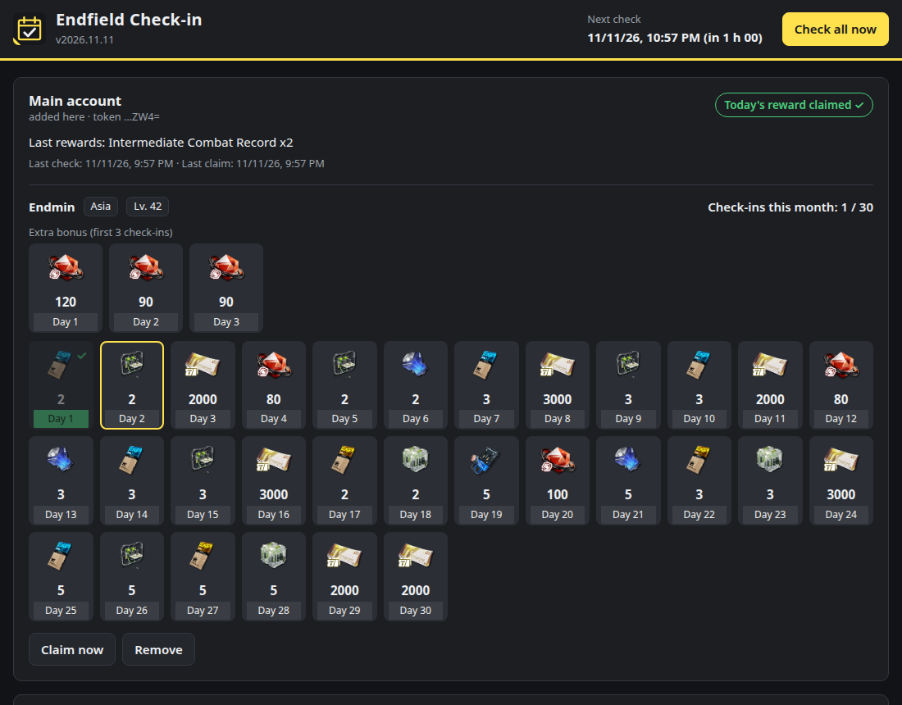

# Endfield Check-in for Unraid

[Français](README.fr.md) · [Report an issue](https://github.com/MrPatates/endfield-checkin/issues)

A Docker container that automatically claims the **Arknights: Endfield** daily login rewards from the [SKPORT sign-in page](https://game.skport.com/endfield/sign-in). Connect your account once in the web UI. The bot then claims the reward every day for every character bound to the account.

This is a community project, not affiliated with GRYPHLINE, Hypergryph or SKPORT.



## Features

- Log in with the **account token** (`ACCOUNT_TOKEN` cookie) or with **email + password**.
- Supports multiple accounts and every Endfield character of each account, with the server detected automatically.
- Checks every 2 hours by default and claims as soon as the reward is available, whatever the reset time of the server region. After a network or server error, it retries after 15 minutes.
- Web UI in the 27 languages offered by Unraid, picked automatically from the browser or fixed with `UI_LANGUAGE`; Arabic is shown right-to-left. It shows the monthly calendar, the first-three-logins bonus, the last rewards, the history and a "Claim now" button.
- Accounts are named automatically after the in-game nickname.
- Optional Discord notifications for claims, errors and expired tokens.
- Small image (~50 MB) with plain Python and no third-party packages. After startup the container switches to `99:100` (nobody:users).

## How it works

The bot makes the same calls as the official page:

1. Exchange the `ACCOUNT_TOKEN` for an OAuth code (`as.gryphline.com`).
2. Exchange the code for a `cred` and a signing token (`zonai.skport.com`).
3. List the Endfield characters bound to the account.
4. Read the attendance status (`hasToday`). If today's reward has not been claimed, send the signed check-in. Requests are signed with HMAC-SHA256 and then MD5, like the website does.

Each check costs one light request per character. The session is cached in memory and renewed from the token automatically.

## Install on Unraid

1. Open the **Apps** tab (Community Applications) and search for **Endfield Check-in**.
2. Click **Install**. Optionally choose the reward language, a Discord webhook or a web UI password, then click **Apply**.
3. Open the **WebUI** from the Docker tab (`http://<unraid-ip>:8080`) and connect your account.

Updates are offered in the Docker tab like for any other container.

## Connect an account

**Token (recommended)**

1. Open <https://game.skport.com/endfield/sign-in> and log in.
2. Press **F12**. In Chrome/Edge, open **Application → Cookies**. In Firefox, open **Storage → Cookies**.
3. Select `https://game.skport.com` and copy the value of the **`ACCOUNT_TOKEN`** cookie.
4. Paste it into the web UI and click **Connect account**. The token is validated before it is saved and the account is named after your in-game nickname, then a first check starts.

**Email + password**

The bot logs in once and keeps only the resulting token. If you tick "Remember", the email and password are also stored in `/config`, so the bot can log in again when the token expires. Accounts created through Google, Apple and similar providers have no password; use the token method for those.

If a token expires and no password is saved, the UI shows **Action required** and Discord notifies you once. Reconnect the account to fix it.

## Settings (template variables)

| Variable | Default | Purpose |
| --- | --- | --- |
| `CHECK_INTERVAL` | `120` | Minutes between checks (30–720). |
| `UI_LANGUAGE` | `auto` | Language of the web UI and Discord notifications. `auto` follows each browser's language; or one of the Unraid locales: `ar_AR`, `bn_BN`, `ca_CA`, `cs_CZ`, `da_DA`, `de_DE`, `el_GR`, `en_US`, `es_ES`, `fr_FR`, `hr_HR`, `hu_HU`, `it_IT`, `ja_JA`, `ko_KO`, `lv_LV`, `nl_NL`, `no_NO`, `pl_PL`, `pt_BR`, `pt_PT`, `ro_RO`, `ru_RU`, `sv_SE`, `uk_UA`, `zh_CN`, `zh_TW`. With `auto`, notifications follow `SKPORT_LANGUAGE`. |
| `SKPORT_LANGUAGE` | `en` | Reward name language, as supported by SKPORT: `en`, `fr_FR`, `de_DE`, `it_IT`, `es_MX`, `pt_BR`, `ru_RU`, `ja`, `ko`, `zh_Hans`, `zh_Hant`, `id_ID`, `th_TH`, `vi_VN`. |
| `DISCORD_WEBHOOK` | empty | Optional Discord webhook URL. |
| `NOTIFY` | `all` | `all` sends claims and errors, `errors` sends problems only, `none` disables notifications. |
| `WEBUI_PASSWORD` | empty | Protects the UI with a password. Any user name is accepted. |
| `ACCOUNT_TOKEN` | empty | Advanced: comma-separated tokens, used instead of the web UI. |
| `ACCOUNT_NAME` | empty | Display name for accounts defined with `ACCOUNT_TOKEN`. Empty: the in-game nickname is used. |
| `RETRY_INTERVAL` | `15` | Minutes before retrying after an error (5–240). |
| `PUID` / `PGID` | `99` / `100` | Owner of the `/config` files. |
| `LOG_LEVEL` | `INFO` | `DEBUG`, `INFO`, `WARNING` or `ERROR`. |

Unraid passes `TZ` automatically, so displayed times and logs use the server time zone.

## Security

- `ACCOUNT_TOKEN` grants access to your account, like a password. It is stored in `/config/accounts.json` with mode `0600` and is never logged. The UI never returns it and shows only its last 4 characters.
- The UI is meant for your local network. Do not expose it to the Internet. Set `WEBUI_PASSWORD` if other people share your network.
- UI actions are protected against CSRF: they require a token and a JSON body, and the request origin is checked. A strict CSP is applied.
- The container contacts only `as.gryphline.com`, `zonai.skport.com` and your Discord webhook if one is configured. Your browser loads reward icons from `static.skport.com`.

## Translations

The interface catalogs live in [`app/endfield_checkin/static/lang/`](app/endfield_checkin/static/lang/), one JSON file per Unraid locale, with `en_US.json` as the master. A missing or empty entry falls back to English. Most translations were generated automatically and have not been reviewed by native speakers, so corrections are welcome. Keep the keys and placeholders such as `{n}` or `{name}` unchanged, use plain text only, then run the tests.

## Limitations

The bot relies on the undocumented API of the SKPORT website, reverse-engineered from the official page and from open-source projects. It may stop working if SKPORT changes that API. Automating sign-ins may also go against the service's terms of use, so use it at your own risk.

## Development

Run the tests (they use a bundled fake SKPORT server) and build the image:

```bash
cd tests && python3 -m unittest discover -s . -t . -v
podman build --format docker -t endfield-checkin:dev .  # or: docker build
```

The [`docker.yml`](.github/workflows/docker.yml) workflow runs the tests, then publishes `ghcr.io/mrpatates/endfield-checkin` for amd64 and arm64 on every push to `main` and on every `v*` tag. After the first publish, make the GHCR package **public** so Unraid can pull it without credentials.

License: GPL-3.0-or-later.
